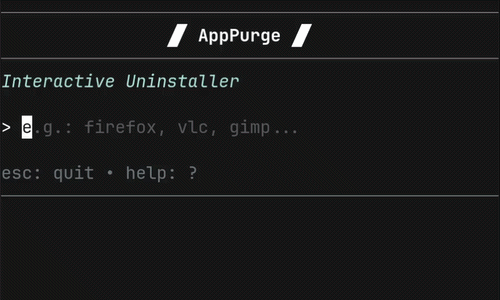

# AppPurge

AppPurge is an interactive Linux uninstaller. Search installed programs from one terminal interface, review what will be removed, and uninstall through the package manager that owns each program.

It is written in Go and uses [Bubble Tea](https://github.com/charmbracelet/bubbletea) and [Lip Gloss](https://github.com/charmbracelet/lipgloss).



## Supported sources

| Source | What AppPurge searches |
| --- | --- |
| APT | Installed packages on Debian, Ubuntu, Linux Mint, and related distributions |
| Pacman | Installed packages on Arch Linux, Manjaro, EndeavourOS, Omarchy, and related distributions |
| Flatpak | Installed applications in detected user and system installations |
| Snap | Installed Snap packages |
| AppImage | `.AppImage` files directly inside `~/Applications`, `~/Downloads`, `~/Descargas`, and `~/.local/share/Applications` |
| Web App | User menu launchers created with `omarchy-launch-webapp` |

Available package managers are detected automatically. Sources whose command-line tools are not installed are skipped. AppImage scanning checks only the listed directories, not their subdirectories.

## Requirements

- Linux
- Go **1.27 or later** to build from source
- GNU Make to use the provided build commands
- The command-line tool for each package manager you want to search; AppImages do not require a package manager

Uninstalling system packages requires `sudo`. AppPurge asks for the password in the TUI when needed. User-scoped Flatpak apps and AppImages do not require system privileges.

## Install

Build and install from source:

```bash
git clone https://github.com/Zobercito/apppurge.git
cd apppurge
make build        # creates build/apppurge
make install      # installs to /usr/local/bin/apppurge (asks sudo for the copy)
```

Or install with Go:

```bash
go install github.com/Zobercito/apppurge@latest
```

To run a local build without installing it:

```bash
./build/apppurge
```

## Use

```bash
apppurge                # open the search screen
apppurge firefox        # open results for a search immediately
apppurge --source pacman firefox  # limit the initial results to Pacman
apppurge --dry-run firefox        # print a plan if exactly one program matches
apppurge --dry-run --complete firefox  # preview complete mode without uninstalling
apppurge --help         # show command-line help
apppurge --version      # show version information
```

Search terms must contain at least two characters. AppPurge shows up to 200 results per source.
`--source` accepts `apt`, `pacman`, `flatpak`, `snap`, `appimage`, or `webapp`. The CLI dry-run exits without uninstalling; if the search is ambiguous, narrow the term or specify a source.

### Keyboard controls

| Key | Action |
| --- | --- |
| `↑` / `↓`, `k` / `j` | Move through results or choices |
| `PgUp` / `PgDn` | Move by a page |
| `Enter` | Select a result or confirm the highlighted choice |
| `1`–`7` | Show all sources, or filter to APT, Flatpak, Snap, AppImage, Pacman, or Web Apps |
| `i` | View package information and reverse dependencies |
| `d` | Preview the uninstall operation |
| `h` | View recent uninstall attempts |
| `?` | Open help for the current flow |
| `Esc` | Return to the previous screen or leave search |

The uninstall flow lets you choose a mode, review dependency and removal information where supported, and confirm before running the package manager.

## Uninstall modes

- **Normal** asks the package manager to remove the selected program and keeps user data that AppPurge does not explicitly target.
- **Complete** uses the package manager's purge or recursive-removal option where available, then removes the user-data directories listed on the confirmation screen. Pacman may remove unneeded dependencies; the confirmation screen shows its removal preview. For Snap, this mode uses `snap remove --purge`, which prevents a new automatic data snapshot; snapshots already on the system are left alone. For AppImages, it can also remove user `.desktop` entries whose `Exec` field points directly to that file. AppPurge only targets the displayed paths and cannot guarantee removal of every cache or application data file.
- **Web App** removes only the matching user `.desktop` launcher created by `omarchy-launch-webapp`. It leaves the website and browser profile data untouched.

Package-manager behavior differs by source. In particular, system-level package removals can affect other programs that depend on the selected package. Review the confirmation details before proceeding.

## Data and history

AppPurge keeps a local history of the last 100 uninstall attempts at:

```text
${XDG_CONFIG_HOME:-~/.config}/appurge/history.json
```

The history is a JSON file and can be viewed from the results screen with `h`. It is informational; the TUI does not provide an undo action.

## Development

```bash
make build    # compile to build/apppurge
make test     # run tests with the race detector and coverage
make lint     # run golangci-lint
make fmt      # format Go files
make clean    # remove build/ and coverage.out
```

## License

AppPurge is distributed under the [GNU General Public License v3.0](LICENSE).
